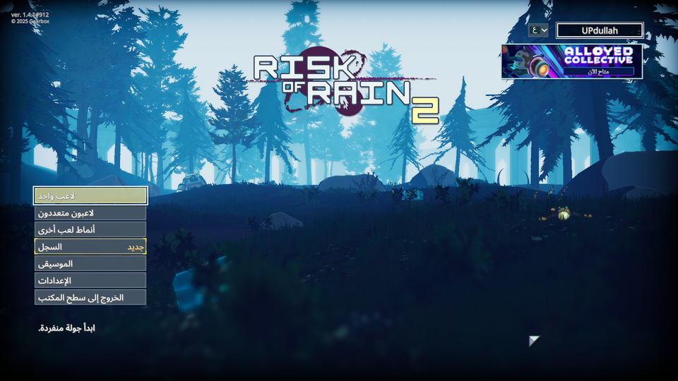
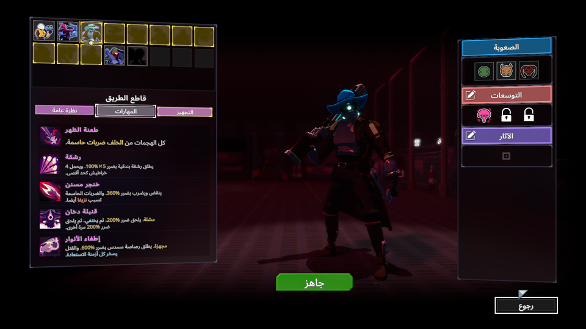
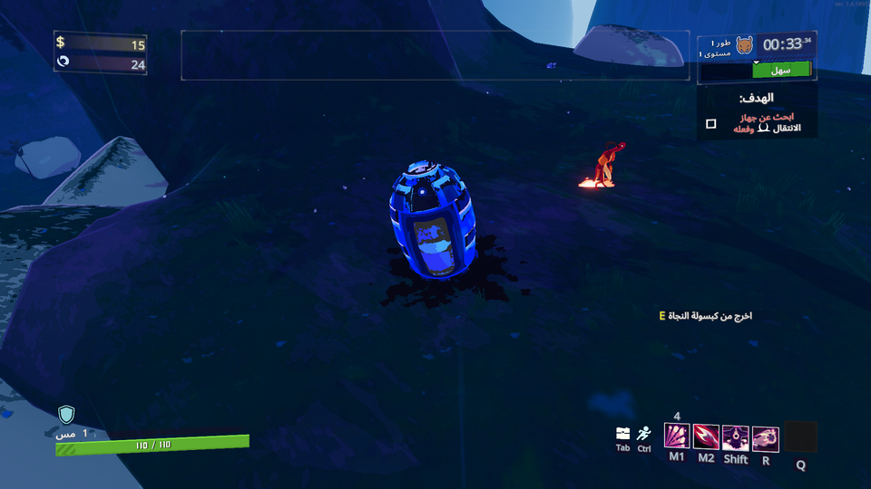
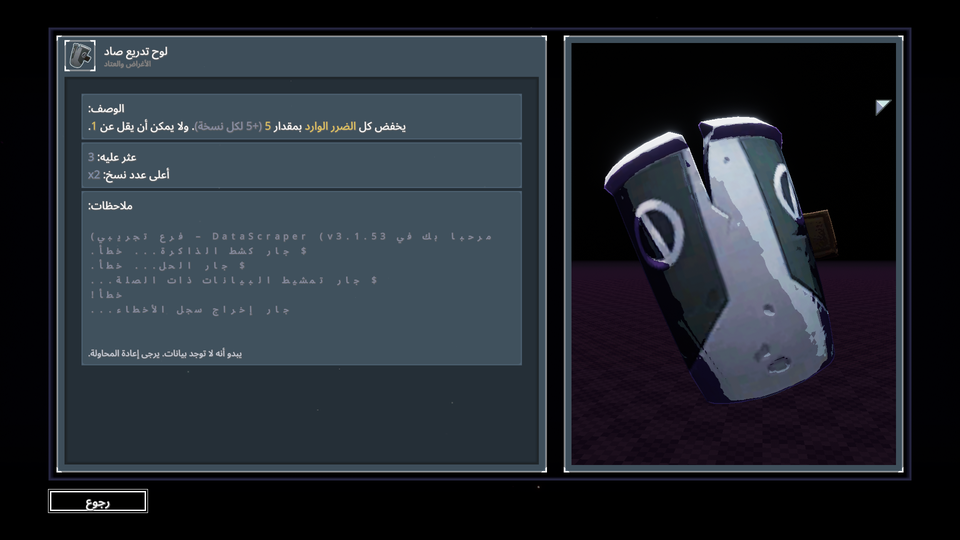

<div dir="rtl">

# ‏Risk of Rain 2‎ بالعربية

تعريب للعبة [‏Risk of Rain 2‎](https://store.steampowered.com/app/632360/) على هيئة إضافة:
القوائم والإعدادات والناجون ومهاراتهم والأغراض والعتاد والمُسيّرات والوحوش والأطوار والإنجازات
والسجلّ وحوارات الزعماء ومشهد الافتتاح — **4,915 نصًّا من 5,578**.

لا يُعدَّل أي ملف من ملفات اللعبة: كل شيء داخل `BepInEx/plugins/RoR2Arabic`، وحذفه وحده
يُعيد اللعبة إلى الإنجليزية تمامًا كما كانت. ولا يؤثر على اللعب الجماعي.

</div>

[](../../releases/latest)
[](LICENSE)
[](#)









<div dir="rtl">

## في سطور

| | |
|---|---|
| **اللعبة المدعومة** | ‏Risk of Rain 2‎ — النسخة **1.4.1#912** |
| **ما يعرّبه** | القوائم والناجون والأغراض والعتاد والمُسيّرات والوحوش والأطوار والإنجازات والسجلّ |
| **ملفات اللعبة** | لا يُمَس منها شيء؛ كل شيء داخل `BepInEx/plugins/RoR2Arabic` |
| **الإزالة** | زر «إزالة» في المثبّت، أو حذف المجلد يدويًا |
| **اللعب الجماعي** | يعمل؛ لا يظهر وسم `mod` على غرفتك |
| **متطلبات إضافية** | **BepInEx 5.4.21 (x64)** |

## قبل التثبيت: BepInEx

التعريب إضافة تعمل من خلال **BepInEx**، فلا بد من تثبيته أولًا:

1. نزّل **BepInEx 5.4.21** نسخة **x64** من [صفحة إصداراته](https://github.com/BepInEx/BepInEx/releases).
2. فُكّ ضغطه داخل مجلد اللعبة، بحيث يصير مجلد `BepInEx` بجوار `Risk of Rain 2.exe`.
3. شغّل اللعبة مرة واحدة ثم أغلقها.

ومن يستعمل r2modman أو Thunderstore Mod Manager فـBepInEx موجود مسبقًا داخل مجلد الملف
الشخصي، ويكفي توجيه المثبّت إليه.

## المتطلبات

| النظام | ما يلزم |
|---|---|
| ويندوز 10 أو 11 | PowerShell (مثبَّت مسبقًا) وBepInEx |
| لينكس | `bash`، وBepInEx داخل مجلد اللعبة |
| ستيم ديك | وضع سطح المكتب (Desktop Mode) وBepInEx |
| اللعبة | نسخة Steam من ‏Risk of Rain 2‎ |

## التنزيل

من صفحة **[الإصدارات](../../releases/latest)** نزّل `RoR2Arabic-1.0.1.zip` (نحو 510 ك.ب)،
ثم **فُكّ ضغطه** قبل أي خطوة أخرى.

## التثبيت على ويندوز

1. **أغلق اللعبة** إن كانت مفتوحة.
2. فُكّ ضغط الملف: زر الفأرة الأيمن ← **Extract All…** ← **Extract**.
3. افتح المجلد الناتج، وانقر نقرًا مزدوجًا على `install-windows.bat`.
4. تفتح نافذة صغيرة تعثر على اللعبة وحدها. اضغط **تثبيت**.
5. إن لم يجدها، اضغط **استعراض…** وحدّد المجلد الذي يحتوي على `Risk of Rain 2.exe`.

إن ظهرت رسالة عن الصلاحيات، انقر على `install-windows.bat` بزر الفأرة الأيمن واختر
**تشغيل كمسؤول**.

## التثبيت على لينكس

فُكّ الضغط، ثم من داخل المجلد:

</div>

```bash
./install.sh
```

<div dir="rtl">

ولتحديد مسار اللعبة بنفسك:

</div>

```bash
./install.sh "/path/to/Risk of Rain 2"
```

<div dir="rtl">

وإن ظهرت رسالة `Permission denied`، فمعنى ذلك أن مدير الملفات لم يحفظ صلاحية التنفيذ:

</div>

```bash
chmod +x install.sh && ./install.sh
```

<div dir="rtl">

## التثبيت على ستيم ديك

1. اضغط **STEAM** ← **Power** ← **Switch to Desktop**.
2. ثبّت BepInEx في مجلد اللعبة كما في الخطوات أعلاه (اللعبة تعمل عبر Proton).
3. افتح **Konsole** واكتب:

</div>

```bash
cd ~/Downloads/RoR2Arabic-1.0.1
./install.sh
```

<div dir="rtl">

4. سيجد المثبّت اللعبة في مكتبة Steam على الجهاز أو بطاقة الذاكرة. ثم عُد إلى وضع اللعب.

## تشغيل التعريب

شغّل اللعبة ← اضغط قائمة اللغات في أعلى يمين الشاشة ← اختر **العربية**.

اختر اللغة من داخل اللعبة لا من ملف `config.cfg`، فاللعبة تحفظ اللغة في Steam Cloud
وتستعيدها فوق أي تعديل يدوي.

## الإزالة

- ويندوز: شغّل `install-windows.bat` واضغط **إزالة**.
- لينكس: `./install.sh --uninstall`

أو احذف مجلد `BepInEx/plugins/RoR2Arabic` يدويًا؛ لا يضع المثبّت شيئًا خارجه. وإزالة BepInEx
نفسه اختيارية، ولن تحتاجه بعدها إلا لتعديلات أخرى.

## بعد تحديث اللعبة

تحديث اللعبة قد يغيّر مفاتيح النصوص. بعد كل تحديث:

1. نزّل أحدث إصدار من التعريب.
2. ثبّته فوق القديم؛ المثبّت يستبدل المجلد كاملًا.
3. إن اختفت العربية من قائمة اللغات، تحقّق من ملفات اللعبة في Steam ثم أعد التثبيت.

## إن لم يعمل

| ما تراه | السبب | الحل |
|---|---|---|
| لا تظهر **العربية** في قائمة اللغات | BepInEx غير مثبّت أو نسخة خطأ | ثبّت BepInEx 5.4.21 x64 داخل مجلد اللعبة |
| نافذة BepInEx السوداء لا تظهر عند التشغيل | BepInEx لم يُثبَّت في المجلد الصحيح | يجب أن يصير `BepInEx` بجوار `Risk of Rain 2.exe` |
| الإضافة لا تُحمَّل | ملفات في مجلد خطأ | أعد التثبيت وحدّد المجلد الذي فيه `Risk of Rain 2.exe` |
| الحروف مربّعات | الخط لم يُحمّل | أعد التثبيت بمجلد كامل، وتأكد من `RoR2Arabic-Regular.ttf` |
| النص محاذى لليسار | تخطيطات اللعبة تحدد المحاذاة | سلوك متوقع، لا خلل |
| اللعبة صارت «modded» في الغرف | تعديل آخر غير هذا | أزل التعديلات الأخرى؛ هذا التعريب لا يرفع العَلَم |

## أسئلة سريعة

**هل يحتاج أصدقائي التعريب؟** لا. كل لاعب يرى نصوصه بلغته.

**هل يتأثر اللعب الجماعي أو الإنجازات؟** لا. الإضافة لا ترفع `RoR2Application.isModded`،
فتبقى غرفتك في نفس قوائم المضيفين، وتبقى التحديات المنشوريّة تعمل.

**هل يعمل مع تعديلات أخرى؟** نعم تقنيًا، لكن أي تعديل آخر قد يرفع وسم `mod` ويفصلك عن
اللاعبين العاديّين.

**لماذا بقيت نصوص بالإنجليزية؟** أسماء صنّاع اللعبة ونصوص المحرّك وصيغ الأرقام لا تُترجَم،
وبعض مداخل السجلّ لا تزال قيد الترجمة.

## ما ينبغي معرفته

- **اللعب الجماعي يعمل كالمعتاد.** الإضافة لا ترفع `RoR2Application.isModded`، وهو العَلَم
  الذي يضيف وسم `mod` إلى الغرفة ويفصل المُطابقة عن اللاعبين العاديّين.
- **ملفات اللعبة لا تُمَس.** كل شيء داخل مجلد واحد، وحذفه وحده كافٍ للتراجع.
- النصوص مكتوبة بلا تشكيل، لأن محرّك النصوص في اللعبة لا يضع الحركات في مواضعها الصحيحة.
- النصوص في القوائم مُحاذاة إلى اليسار لا إلى اليمين، لأن المحاذاة تحدّدها تخطيطات اللعبة.
- المترجَم **4,915** نصًّا من **5,578**. وما بقي بالإنجليزية مقصود: أسماء صنّاع اللعبة (315)،
  ونصوص المحرّك والصيغ (18)، ونصوص تركها المطوّرون فارغة (60)، ومداخل سجلّ الأغراض والعتاد
  (270) لا تزال قيد الترجمة.

## للمهتمين تقنيًا

| ما يفعله المثبّت | التفصيل |
|---|---|
| ينسخ | `RoR2Arabic/` إلى `BepInEx/plugins/` |
| لا يعدّل | أي ملف من ملفات اللعبة أو حفظاتها |
| يتطلب | BepInEx 5.4.21 x64، ويتحقق من وجوده قبل النسخ |
| الإزالة | حذف المجلد نفسه، لا أكثر |

شرح آلية العمل وبنية المشروع في [docs/internals.md](docs/internals.md)، ودليل المصطلحات
وقواعد الصياغة في [docs/glossary.md](docs/glossary.md).

## الخطوط والتراخيص

الخط المستخدم [Noto Sans](https://github.com/notofonts/latin-greek-cyrillic) — وهو خط اللعبة
نفسه — مدموجًا مع [Noto Sans Arabic](https://github.com/notofonts/arabic)، وكلاهما برخصة
SIL Open Font License 1.1.

شيفرة المشروع برخصة MIT. هذا عمل غير رسمي من المعجبين، ولا صلة له بمطوّري اللعبة.

## الإبلاغ والمساهمة

افتح [مشكلة](../../issues) واذكر النص كما ظهر وأين رأيته في اللعبة، وأرفق صورة إن أمكن.
وإن ظهر سطر قبل السطر الذي يسبقه داخل صندوق ما، فتلك لوحة لم تُقَس بعد؛ اذكر اسم اللوحة.

</div>
